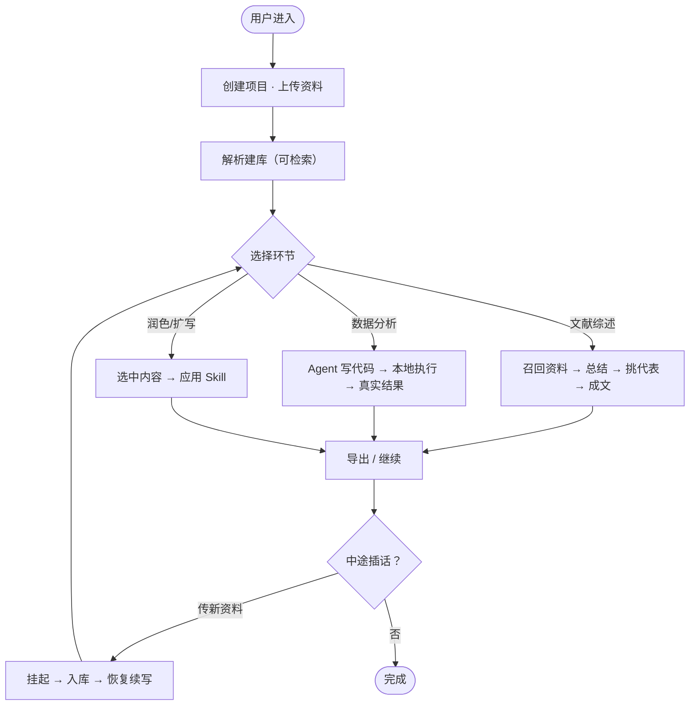
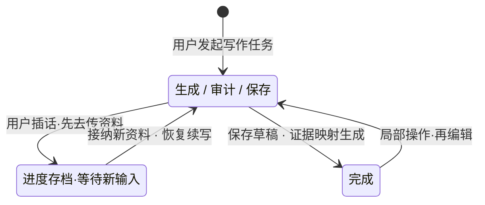

> 实现同步（2026-10-08）：本文为 v2 需求，当前实现状态以《迭代基线.md》为准。当前界面接入 DeepSeek；资料存储与计算本地化，但调用远程模型会传输任务相关文本和资料片段。规则审计与来源映射用于降低虚构风险，不能保证“绝不编造”。

---

> TL/DR：AI 论文宠物是一个**本地优先**的中文社科论文写作 Agent，以"用户上传的资料库"为唯一证据源，覆盖「资料库与检索 → 文献综述写作 → 真代码数据分析 → 全环节写作/润色」四类能力，并支持在**任意写作环节进入与退出**（局部操作 + 会话中断恢复）。核心主张是"只基于你上传的资料写作，每个观点都能追溯到具体文献页码，绝不编造"——这是大厂云端 SaaS 天生做不到的（必须联网、数据出域）。本期不含聚类建主题地图（类 CiteSpace），该功能移至下个版本。

---

**版本变更记录**

| **版本 / 日期**        | **修改人** | **变更摘要**                                                                | **CR / 评审** |
| ------------------ | ------- | ----------------------------------------------------------------------- | ----------- |
| v2.0.0 / 2026/9/30 | 阮涵      | 参照 FilFil.TV PRD 模板重组章节结构；重定义 Agent 能力边界；新增"需求明细"标准用例与"原型展示"；聚类功能移至下个版本 | —           |

# 需求背景及定义

## 一句话概述

AI 论文宠物是本地优先的中文社科论文写作 Agent：用户上传文献与数据后，产品以这些资料为唯一证据源，帮助完成文献综述、实证数据分析与全文润色，并保证"每个观点可溯源、不编造"；同时支持在写作的任何环节进入或退出。

## 目标用户及需求

目标用户：人文社科类（社会学 / 经济学 / 教育学 / 管理学等）本科、硕士、博士，写论文时资料散落、不敢信通用 AI 编的文献、不会写代码跑数据。

- 文献综述焦虑型：资料多、不知如何按"流派/研究分支"组织，需要自动召回相似观点并挑代表文献；
- 实证写作型：有 CSV/XLSX 数据，但不会写 Python 做统计与画图，需要 Agent 真正编写并运行代码；
- 反复打磨型：成稿后需要针对段落/章节做润色、扩写、降重、改实证风格，且不希望重跑整篇；
- 谨慎合规型：极度在意引用真实、不编文献、资料本机存储。

## 背景与现状问题

现有通用写作工具（秘塔写作猫、通义等）强在校对/润色，弱在"基于用户自己的资料做证据写作"，且不保证引用溯源、不保证不编文献、GB/T 7714 严谨性一般。海外 Scite / NotebookLM / Elicit 验证了"证据可溯源、不编文献"的需求真实，但它们的窗口是英文 + 云端。本项目窗口是**中文社科 + 本地桌面（资料本机存储）+ 严格不编**，目前无人占住。现状产品（v1）已实现资料库解析、RAG 召回、写作类 Skill 提示词、引用审计、API Key 加密、Word 导出，但聚类、真代码数据分析、动态进/出编排三项能力缺失，且 PRD 缺商业层与标准用例。

## 需求目标

- 以"用户上传资料库"为唯一证据源，写作内容每个观点可追溯到具体文献页码，绝不编造；
- 覆盖文献综述写作、真代码数据分析、全环节写作/润色三类核心能力；
- 支持在任意写作环节进入与退出（局部操作 + 会话中断恢复），不写死单一流程；
- 本地优先、资料本机存储，模型可切换（DeepSeek / OpenAI / 千问 / 智谱 / Kimi）；
- 作为个人产品对外推广，PRD 需补齐竞争差异化、用户画像、GTM 与评估指标。

# 用户角色与权限

| **用户 / 场景** | **触发与核心任务**             | **User Story / 完成表现**     |
| ----------- | ----------------------- | ------------------------- |
| 社科写作者（新用户）  | 创建项目、上传首批文献/数据、首次发起写作任务 | 资料入库可被检索；首篇综述/分析稿带可溯源引用产出 |
| 社科写作者（常态用户） | 持续写作、局部润色段落、跨环节进/出、数据分析 | 在任意环节进入退出不丢上下文；统计结果来自真实数据 |
| 谨慎合规型用户     | 配置本地模型 Key、检查引用溯源       | 每个引用可跳转资料库页码；Key 不以明文存储   |

本产品为本地单用户桌面应用，不新增角色与权限体系，无额外权限差异。

# 功能目标

- 完成「上传资料 → 解析建库 → 文献综述 / 数据分析 / 润色 → 导出」的写作闭环，且任一环节可进入、可退出；
- 文献综述写作自动召回相关资料、总结相似观点、挑代表文献，按研究分支组织而非逐篇流水账；
- 数据分析由 Agent 自主编写 Python 代码并在 Windows LPAC + Job Object 系统沙箱执行，返回真实统计与图表，写作据此组织文字；
- 支持局部操作（选中段落直接应用 Skill）与会话中断恢复（写作中途插入新资料后从断点续写）；
- 本地优先、资料本机存储，模型可切换，引用可溯源、不编文献。

# 核心用户流程

## 核心对象关系

| **对象**  | **用户可见内容 / 标识**             | **关系与边界**                               |
| ------- | --------------------------- | --------------------------------------- |
| 项目      | 项目名称、题目、类型、学科、引用格式、研究目标     | 一个项目对应一个资料库与一批草稿；本地存储于 userData         |
| 资料      | 文件名、解析状态、分块数、可检索标记          | 用户上传的 PDF/文档/数据，解析后切分为知识块，作为唯一证据源；不联网检索 |
| 证据映射    | 引用标记 E1→文献名+页码/分块           | 写作产出中的每个引用可跳转资料库对应位置                    |
| Skill   | 写作类（选题/综述/实证/润色等）、能力类（数据分析） | 写作类为提示词规则；能力类为可执行工具；本期仅数据分析为能力类         |
| 会话 / 任务 | 进行中 / 挂起 / 恢复 / 完成          | 支持中断挂起与恢复；本期不含聚类地图对象                    |

## 主链路

## 用户状态图

## 可观察状态与迁移约束

| 类别   | 规则                                       |
| ---- | ---------------------------------------- |
| 任务状态 | 进行中 / 挂起 / 恢复 / 完成；挂起时进度存档，恢复后从断点继续，不重来  |
| 证据约束 | 无资料或工具结果时不得生成实证事实，系统拒绝保存（v1 审计机制）        |
| 数据边界 | 资料、数据库、Key 存本机 userData；不默认联网；不查外部真伪     |
| 模型切换 | DeepSeek / OpenAI / 千问 / 智谱 / Kimi，无需改代码 |

# 需求说明

需求编号 LIB / WRITE / ANA / SKILL / FLOW / SEC 与模块对应；本期全部为 P0（推广前必须落地）。交互原型见各用例"界面描述"与"原型展示"一节；线框图以线上安装包真实界面为准，文中为占位线框。

## 需求列表

| **功能板块**      | **子需求范围**        | **具体覆盖**                       | **优先级** |
| ------------- | ---------------- | ------------------------------ | ------- |
| 资料库与检索        | LIB-01～02（2 项）   | 上传并解析入库、RAG 语义+关键词召回           | P0      |
| 文献综述写作        | WRITE-01（1 项）    | 自动召回、总结相似观点、挑代表文献、按分支组织        | P0      |
| 数据分析（真代码）     | ANA-01（1 项）      | Agent 编写 Python 代码、本地本地执行、真实结果 | P0      |
| 写作 / 润色 Skill | SKILL-01～02（2 项） | 选题规划、局部操作（段落级应用 Skill）         | P0      |
| 任意环节进/出       | FLOW-01（1 项）     | 会话中断挂起与恢复                      | P0      |
| 安全与本地优先       | SEC-01（1 项）      | API Key 加密、模型可切换、资料本机存储         | P0      |

## 需求明细

本节以标准用例规约描述每条需求的可验收行为，字段为：业务描述 / 需求描述 / 行为者 / 前置条件 / 后置条件 / 基本流程 / 异常·分支 / 其他说明 / 界面描述。行为者统一为：主行为者＝社科写作者（按状态细分 S1 新用户 / S2 常态用户），辅行为者＝模型服务（生成/审计）、本地沙箱（执行代码）、存储（SQLite/userData）。

### 资料库与检索

#### UC-LIB-01 上传并解析入库（S1） [P0]

**业务描述：**把用户散落的文献/数据集中为可检索的证据源，是后续一切写作的前提。

**需求描述：**LIB-01 资料库——用户上传 PDF/Word/CSV/XLSX，系统解析文本（PDF/OCR 扫描件需 OCR 语言包），切分为知识块并建立索引；状态由"未解析"转为"已解析·可检索"。

**行为者：**主：新用户（S1）；辅：解析与索引服务、本地存储。

**前置条件：**已创建项目；文件格式受支持；本机有 Node 22.5+（node:sqlite）与可选 Python（数据分析用）。

**后置条件：**资料进入知识库，可检索；生成证据映射所需的文献名与页码元信息。

**基本流程：**1. 用户在资料库拖入/选择文件；2. 系统解析文本并切分（约 900 字/块，含页码标记）；3. 建立索引（神经向量模型可选，缺失时降级为哈希语义）；4. 列表标记为"已解析·可检索"。

**异常·分支：**扫描件无 OCR 语言包 → 标记"需 OCR"，不入库；解析失败 → 提示原因，可重试。

**其他说明：**本期不联网、不查外部真伪；聚类建主题地图不在本期（见"不在本期范围"）。

###### 界面描述

**UI 说明：**见下方线框图——资料库面板含上传区、文件列表（解析状态、分块数）、检索入口。

**交互说明：** 用户把文献 / 数据拖入上传区或点击「上传并解析」，文件进入列表并标记为"解析中"；解析完成后状态变为「已解析·可检索」，同步显示分块数与页码元信息；点击「检索入口」可输入关键词预览召回结果，确认资料已进入可引用证据源。

**按钮：**[上传并解析]；[解析全部]；[检索入口]。

#### UC-LIB-02 写作时检索召回（S2） [P0]

**业务描述：**写作某段时，按当前主题从资料库取最相关分块，作为可引用证据。

**需求描述：**LIB-02 检索——系统根据任务自动生成检索词，按语义 + 关键词召回相关分块（每文档上限、总量上限），返回带文献名与页码的证据列表注入写作上下文。

**行为者：**主：常态用户（S2）；辅：RAG 检索服务。

**前置条件：**资料库至少 1 篇已解析文献。

**后置条件：**写作上下文含证据映射（E1→文献+页码），无资料时不得虚构引用。

**基本流程：**1. Agent 规划检索视角；2. 调用 retrieveMulti 召回；3. 证据以"文献名+页码+知识块"注入；4. 写作产出引用标记。

**异常·分支：**无匹配 → 提示"未检索到可引用资料"，仍允许写概念性内容但禁止编实证。

###### 界面描述

**UI 说明：**检索在写作时自动发生，结果体现在"证据映射"面板（见文献综述写作用例图）。

### 文献综述写作

#### UC-WRITE-01 写文献综述（S2） [P0]

**业务描述：**解决"资料多、不会组织"的痛点，自动把召回的文献按研究分支综合，而非逐篇流水账。

**需求描述：**WRITE-01 文献综述——用户发起"写文献综述"后，Agent 召回相关资料，总结每类相似观点，挑代表性文献，按"研究分支/流派"组织成文，每段至少一处可溯源引用，并梳理分歧与缺口。

**行为者：**主：常态用户（S2）；辅：模型服务、RAG 检索、引用审计。

**前置条件：**资料库已有 ≥2 篇已解析文献；用户给出章节或主题。

**后置条件：**产出综述草稿，含证据映射；每个引用可跳转资料库页码；审计通过后才保存。

**基本流程：**1. 用户输入"写第 X 章文献综述"；2. Agent 规划检索视角并召回；3. 总结相似观点、挑代表文献；4. 按研究分支组织成文；5. 引用审计（无证据不编实证）；6. 保存草稿与证据映射。

**异常·分支：**召回为空 → 仅允许概念性综述并提示缺资料；出现无证据的实证表述 → 拒绝保存并提示补充资料。

**其他说明：**本期综述使用现有 RAG 召回（语义+关键词）；聚类增强（按主题地图定向召回）移至下个版本。

###### 界面描述

**UI 说明：**见下方线框图——中间为章节草稿（含可溯源引用标记 ①②③），右侧为证据映射面板（点击跳转资料库）。

**交互说明：** 左侧章节草稿逐段流式生成，正文中的 ①②③ 为可溯源引用标记；右侧「证据映射」面板列出每条引用对应的文献名与页码（如 E1→《XXX》p.12），点击直接跳转资料库对应分块。选中任意段落后弹出「应用 Skill」入口，可对该段局部润色或扩写，其余段落与引用映射保持不变。

**按钮：**[继续写下一节]；[选中段落 ▸ 应用 Skill]；[导出]。

### 数据分析（真代码）

#### UC-ANA-01 Agent 编写代码并本地执行（S2） [P0]

**业务描述：**解决"有数据不会写代码"的痛点，让 Agent 真的生成并运行代码，而非套固定模板。

**需求描述：**ANA-01 数据分析——用户给定数据文件与任务，Agent 自主编写 Python 代码（描述/推断统计、画图），在 Windows LPAC + Job Object 系统沙箱执行，返回真实结果（统计量、图、表），写作 Skill 据真实结果组织分析段，不得补造。

**行为者：**主：常态用户（S2）；辅：模型服务（生成代码）、本地 Python 沙箱、存储。

**前置条件：**已上传 CSV/XLSX；本机 Python 3.10+ 含 pandas/openpyxl/matplotlib（设置中可配置路径）。

**后置条件：**产出真实统计结果与图；写作内容中的统计量/图来自工具输出；代码与结果可复核。

**基本流程：**1. 用户："对 income 与 score 做相关分析并画散点图"；2. Agent 生成 Python 代码；3. 本地执行；4. 返回 r 值/图/表；5. 写作 Skill 据真实结果写分析段。

**异常·分支：**代码运行报错 → Agent 读报错改代码重试（上限次数）；超时 → 终止并提示；缺依赖 → 提示安装命令。

**其他说明：**区别于 v1 固定脚本——本期为模型生成代码；沙箱隔离，不污染主程序。

###### 界面描述

**UI 说明：**见下方线框图——左侧任务、中间生成的代码与执行结果、右侧真实图表与统计量。

**交互说明：** 左侧输入分析任务（如"对 income 与 score 做相关分析并画散点图"）；中间实时生成 Python 代码与执行日志；点击「运行」在 Windows LPAC + Job Object 系统沙箱执行，右侧返回真实统计量（r 值、p 值等）与图表。确认无误后点「插入分析结果到草稿」，数值与图按写作 Skill 规范嵌入正文，全程不得补造未经验证的结果。

**按钮：**[运行]；[查看代码]；[插入分析结果到草稿]。

### 写作 / 润色 Skill

#### UC-SKILL-01 选题规划（S1） [P0]

**业务描述：**把宽泛主题收敛为可执行研究方案，服务于后续写作。

**需求描述：**SKILL-01 选题规划——用户给出宽泛主题，Agent 输出题目、研究问题、章节框架、摘要/关键词建议；不负责写正文。

**行为者：**主：新用户（S1）；辅：模型服务。

**前置条件：**已建项目、填写题目/学科/研究目标。

**后置条件：**产出研究蓝图（题目+问题+章节+摘要），可进入写作。

**基本流程：**1. 用户："帮我把 X 收敛成研究方案"；2. Agent 输出研究蓝图；3. 用户确认/调整。

**异常·分支：**主题过宽 → 提示收窄；缺材料 → 提示可获得的材料方向。

**其他说明：**属写作类 Skill（提示词规则），不改架构。

###### 界面描述

**UI 说明：**沿用主窗口对话区，输出为结构化研究蓝图卡片。

#### UC-SKILL-02 局部操作·段落级应用 Skill（S2） [P0]

**业务描述：**解决"成稿后只想改一段"的痛点，避免重跑整篇。

**需求描述：**SKILL-02 局部操作——用户在草稿编辑器选中段落/章节，直接"润色这段 / 扩写这段 / 改实证风格"，系统仅对该部分调用对应 Skill。

**行为者：**主：常态用户（S2）；辅：模型服务、草稿存储。

**前置条件：**已有草稿；选中非空内容。

**后置条件：**仅选中部分被改写，其余段落不变；引用映射保留。

**基本流程：**1. 用户选中段落并唤起"应用 Skill"菜单；2. 选择目标 Skill；3. 系统仅对该段重生成；4. 替换原内容，保留引用。

**异常·分支：**选中跨多段 → 按选区处理；Skill 改写破坏引用 → 提示并回滚。

###### 界面描述

**UI 说明：**见下方线框图——左图为草稿编辑器选中段落 + 浮动"应用 Skill"菜单（润色/扩写/改实证风格）。

**交互说明（左图）：** 在草稿编辑器选中目标段落，浮层自动出现「应用 Skill」菜单，列出润色 / 扩写 / 改实证风格；选择后系统仅对选区重生成，选区外内容与原引用映射保持不变；若改写破坏了引用，提示并自动回滚到改写前状态。

**按钮：**[润色这段]；[扩写这段]；[改实证风格]。

### 任意环节进/出

#### UC-FLOW-01 会话中断挂起与恢复（S2） [P0]

**业务描述：**解决"写一半要插入新资料"的痛点，保证任务流可进可出不丢上下文。

**需求描述：**FLOW-01 会话中断恢复——写作进行中用户插话"先停，我去传新文献"，系统挂起当前任务并存档进度；用户上传新资料并解析后，从断点恢复续写，新资料进入召回范围。

**行为者：**主：常态用户（S2）；辅：任务状态机、资料库、模型服务。

**前置条件：**存在进行中的写作任务。

**后置条件：**任务状态由"进行中"转"挂起"再转"恢复"；新资料可被后续召回；进度不重来。

**基本流程：**1. 用户插话请求暂停；2. 系统挂起并存档当前进度；3. 用户上传并解析新文献；4. 用户说"继续"；5. 从断点恢复，新文献进入召回。

**异常·分支：**挂起期间关闭应用 → 下次打开可从存档恢复；恢复失败 → 提示并从最近存档重试。

###### 界面描述

**UI 说明：**见下方线框图——右图为对话区"已挂起"徽标 + 上传新文献 + "恢复续写"状态条。

**交互说明（右图）：** 写作进行中用户插话"先停，我去传新文献"，对话区顶部出现「已挂起」徽标并提示进度已存档；此时可切到资料库上传并解析新文献；回到对话点「恢复续写」，Agent 从断点继续，新文献自动进入后续召回范围。挂起期间关闭应用，下次打开仍可从存档恢复，不需重来。

**按钮：**[挂起]；[恢复续写]；[取消]。

### 安全与本地优先

#### UC-SEC-01 API Key 加密与模型可切换（S1/S2） [P0]

**业务描述：**保证密钥不以明文落盘，且用户不被绑死在单一模型厂商。

**需求描述：**SEC-01 安全——API Key 经系统安全存储（Windows DPAPI 等）加密落盘；模型提供方可在设置中切换（DeepSeek / OpenAI / 千问 / 智谱 / Kimi），无需改代码。

**行为者：**主：写作者；辅：系统安全存储、模型适配层。

**前置条件：**用户持有至少一家服务商的 API Key。

**后置条件：**Key 不明文存储；切换模型后立即生效。

**基本流程：**1. 用户在设置填写 Key；2. 系统加密存储；3. 选择模型提供方；4. 调用时解密使用。

**异常·分支：**Key 缺失 → 仅保存任务草稿，不生成正文、不编文献。

###### 界面描述

**UI 说明：**设置面板含"API 服务商与 Key""数据分析环境（Python 路径）"；沿用主窗口设置入口。

# 原型展示

本期原型以**线上安装包（GitHub Release 构建产物）**为准。下列线框图为基于现有代码与文档推断的占位稿，精确视觉与交互以你运行安装包后的截图替换。

- 主窗口 = 工作台（资料库 + 对话/草稿 + 证据映射），桌面宠物浮窗，设置面板；
- 资料库：上传/解析/检索入口（见 `library.svg`）；
- 文献综述写作：章节草稿 + 可溯源引用 + 证据映射（见 `writing.svg`）；
- 数据分析：代码 + 真实图表（见 `analysis.svg`）；
- 任意环节进/出：局部操作菜单 + 会话挂起/恢复（见 `local-interrupt.svg`）。

# 技术形态与边界

## 技术实现形态

- 桌面端基于 Electron + Node（node:sqlite）；模型调用为自研 OpenAI 兼容适配层（fetch 直连各家 /chat/completions，自研 SSE 解析），默认 DeepSeek；
- 资料库：本地解析 + 切分 + 向量/哈希混合索引（rag-store）；
- 写作类 Skill：SKILL.md 提示词规则注入 system prompt；数据分析为能力类 Skill，经 function calling 触发本地 Python 沙箱；
- 编排将从 v1 写死的 7 阶段流水线重构为"识别当前环节 → 动态调 Skill/工具 → 可挂起恢复"。

## 对底层的能力要求（反向约束）

- 本地 Python 3.10+ 与 pandas/openpyxl/matplotlib，可在隔离本地执行用户代码；
- 文本与 OCR 解析（扫描件需 chi_sim/eng 训练数据，需随包或引导安装）；
- 可切换的多厂商模型适配与 Key 安全存储；
- 任务状态机支持挂起/恢复与进度存档；
- Word 导出与 GB/T 7714 引用格式化。

## 成本测算与预算约束

- 本地应用无服务器成本；成本来自用户自有 API Key 的模型调用费用（按各家计费）；
- 推广期可默认 DeepSeek（低成本）降低用户门槛；
- OCR 语言包、神经向量模型（可选）体积较大，需在安装包或引导流程中处理，避免开箱不可用。

# 非功能需求

## 性能与反馈

- 解析建库：百篇文献内可在数分钟完成；单轮召回延迟可忽略；
- 写作生成有流式反馈；任务状态（进行中/挂起/完成）可见。

## 数据与操作一致性

- 引用标记与证据映射一致；草稿、证据映射、资料库页码口径一致；
- 数据分析结果须来自真实文件，写作内容与工具输出一致。

## 可访问性与快捷键

- 沿用桌面应用常规快捷键；选中段落唤起 Skill 菜单可达。

## 深浅色模式

- 应用已有"主题外观"设置（浅/深），PRD 不额外要求。

## 安全与隐私

- API Key 经系统安全存储加密；资料、数据库、Key 存本机 userData；
- 默认不联网、不查外部真伪；不向云端上传用户资料。

# 埋点与可观测性

## 埋点建议

| **事件（建议命名）**                             | **用途**      |
| ---------------------------------------- | ----------- |
| project_create / doc_upload / doc_parsed | 评估资料库激活     |
| task_start / task_save / skill_applied   | 评估写作环环节使用   |
| analysis_run / analysis_success          | 评估数据分析采用率   |
| session_suspend / session_resume         | 评估任意环节进/出使用 |

## 评估指标

- 产品层：资料库激活率、写作任务完成率、数据分析采用率、局部操作使用率、会话恢复率；
- 推广层：安装转化率、7 日留存、付费/捐赠意愿（作为个人产品后续商业化参考）；
- 质量层：引用可溯源率（随机抽段落可跳转比例）、无证据编实证拦截率。

# 异常及降级处理

## 生成失败与返还

- 模型调用失败/超时 → 提示并重试；无 API Key → 仅保存任务草稿，不生成、不编；
- 数据分析代码运行失败 → Agent 读报错改代码重试，超限终止并提示。

## 任务异常与恢复

- 会话挂起期间关闭应用 → 下次从存档恢复；
- 恢复失败 → 提示并从最近存档重试；
- OCR/向量模型缺失 → 降级（哈希语义 / 标记需 OCR），不崩溃。

# 依赖与影响范围

| **事项**                    | **类型** | **责任方** | **状态/时点**    |
| ------------------------- | ------ | ------- | ------------ |
| 模型服务商 API Key（DeepSeek 等） | 用户侧    | 用户      | 用户自配         |
| 本地 Python 与数据分析依赖         | 用户侧    | 用户/安装包  | 设置可配置路径      |
| OCR 语言包（chi_sim/eng）      | 依赖     | 产品      | 待随包分发或引导安装   |
| 神经向量模型（可选）                | 依赖     | 产品      | 待引导安装，缺失降级哈希 |
| 编排器重构（动态 + 可恢复）           | 研发     | 研发      | 本期 P0        |

# 验收标准

## 功能验收表

| **需求**      | **验收点**            | **通过标准**                  |
| ----------- | ------------------ | ------------------------- |
| 资料库与检索      | 上传后解析、可检索；写作时召回带页码 | 解析状态正确；召回返回文献名+页码；无资料不编实证 |
| 文献综述写作      | 自动总结相似观点、挑代表、按分支组织 | 每段 ≥1 可溯源引用，随机抽 5 段全部可跳转  |
| 数据分析（真代码）   | Agent 生成代码并本地执行    | 代码可独立运行复现；结果 100% 来自真实文件  |
| 写作/润色 Skill | 选题规划；选中段落应用 Skill  | 仅选中部分改写，其余哈希不变；引用保留       |
| 任意环节进/出     | 会话挂起→传新资料→恢复       | 进度不丢；恢复后新资料可参与召回          |
| 安全与本地优先     | Key 加密、模型可切换       | Key 非明文；切换后即时生效           |

# 不在本期范围

- **聚类建主题地图（类 CiteSpace，按观点/方法分簇）—— 移至下个版本（v2.1）**：本期文献综述使用现有 RAG 召回（语义+关键词），不依赖聚类；聚类建库将在下个版本作为增强项实现；
- 联网检索与文献真伪核查：范围限定为用户上传的本地资料库，不联网；
- 多人协作 / 云端同步：本地单用户；
- 替代 Zotero 的文献管理：只做写作侧，引用管理可对接但非核心；
- 纯英文顶刊场景：窗口是中文社科 + 本地 + 不出域。
