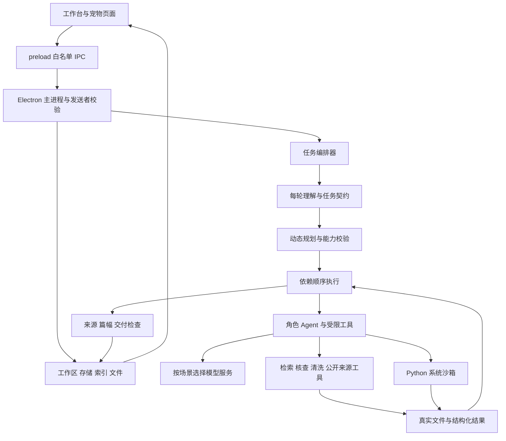

# AI论文宠物技术实现文档

更新日期：2026-10-16。对应软件版本 `0.1.3` 的当前源码；产品范围见[产品需求书](../产品需求书.md)。本文供研发维护、交互联调和产品验收使用。

系统是 Electron 桌面程序：主进程负责本机资源与任务编排，渲染进程负责工作台和宠物；pi harness 处理模型与角色执行，Python 在 Windows 系统沙箱中进行数据计算。所有角色共享产品的数据与权限边界，技能正文不能授予额外工具权限。

## 1 技术栈与运行形态

| 层 | 当前实现 | 关键入口 |
| --- | --- | --- |
| 桌面容器 | Electron 44.7.0，Windows x64，系统托盘和多窗口 | `electron/main.js`、`electron/start.js` |
| 工作台 | 原生 HTML、CSS、JavaScript，无 React 状态层 | `src/feed.html`、`src/feed.js`、`src/styles/feed.css` |
| 宠物 | 独立渲染页面和形象资源 | `src/index.html`、`src/renderer.js` |
| IPC 桥 | contextBridge 白名单 API，主进程受信发送者校验 | `electron/preload.js`、`electron/app-security.js` |
| 模型编排 | pi-agent-core、pi-ai，CommonJS 主流程动态加载 ESM | `electron/agent/orchestrator.js`、`electron/pi/` |
| 数据持久化 | Node 内置 SQLite，JSON 对象存储与关系归属，文件副本 | `electron/sqlite-workspace.js`、`electron/workspace-store.js` |
| 文献解析与检索 | 本地提取、OCR、混合检索与证据快照 | `electron/document-parser.js`、`electron/ocr-runtime.js`、`electron/rag-store.js` |
| 分析执行 | 内置 Python 3.14.8，Windows LPAC + Job Object | `electron/tools/code-analysis.js`、`electron/sandbox/windows-sandbox.js` |
| 文件预览 | 独立 DOCX/表格 iframe、PDF.js 与本地图像渲染 | `electron/upload-preview.js`、`src/*-preview.js` |
| Word 导出 | docx 库，章节、表格、脚注及来源信息 | `electron/word-export.js` |
| 项目备份 | JSZip、清单、SHA-256 校验和标识重映射 | `electron/project-backup.js` |

开发要求 Node.js 22.19 及以上；具体依赖锁定以 `package-lock.json` 为准。应用运行不要求终端用户自行安装 Excel 或 Word 来预览文件。

## 2 模块架构



图中是模块依赖，不表示每轮必须经过采集、清洗、分析和写作。RunEngine 当前按依赖顺序执行任务，不应把多个角色解释为所有步骤并发。

### 2.1 前端职责

| 文件 | 职责 |
| --- | --- |
| `src/feed.js` | 工作区加载、项目/对话切换、流式消息、交互卡、文件点击、预览标签、导出入口和页面协同 |
| `src/project-experience.js` | 当前项目资源导航、成果分类和检索、章节来源选择、资料筛选、文献信息编辑、备份入口、渐进表单 |
| `src/writing-workbench.js` | 当前稿阅读编辑、防丢稿、全文修订、接受/取消、单次撤销、引用检查和导出检查 |
| `src/text-diff.js` | 文本差异计算、Unicode 处理、长文本计算上限和分块回退 |
| `src/reading-tools.js` | 文档查找、PDF 页码定位和工作表单元格定位 |
| `src/chat-markdown.js` | 对话 Markdown 渲染及受控产物链接 |
| `src/task-progress.js` | 执行步骤状态、可见进度和结束摘要规则 |
| `src/docx-preview.js`、`src/spreadsheet-preview.js` | 沙箱 iframe 中的实际文档与表格渲染 |

前端沿用现有全局工作区状态和 DOM 事件协作。新增模块不是独立 SPA，不另建一套项目状态。维护时须注意异步请求返回的项目/对话归属以及页面切换后的旧 DOM 引用。

## 3 每轮 Agent 执行链路

### 3.1 理解与规划

1. `draft-generate` 接收项目和请求，建立 AbortController，并进入 `agent/orchestrator.js`。
2. 加载当前项目、对话、真实文件、已有方案与有效结果；构造必要上下文和历史记忆。
3. 普通新任务由 `pi/intent.mjs` 调用规划场景模型，把用户自然语言转换成意图和任务契约；已有批准或恢复存档的执行入口先承接并校验绑定状态，不必重复调用理解模型。无效 JSON/字段会内部重试一次；认证或网络异常按服务错误处理，不改成泛泛需求追问。
4. `pi/planner.mjs` 读取角色和技能目录，生成任务 DAG；`flow-policy.js` 与 `pipeline-policy.js` 校验角色、分支、依赖、任务覆盖和授权。
5. `pi/run-engine.mjs` 拓扑排序，按顺序执行；完成项可从有效存档复用；依赖环、未知角色、缺失依赖或超过 18 个任务均拒绝。
6. 需要分析批准或必要澄清时，通过 `interaction-broker.js` 等待当前运行的用户响应；不是结束本轮后要求用户再发“继续”。
7. 执行结果通过回调更新流式界面、任务状态、阶段摘要及存档；交付经审计后持久化。

任务契约保留的主要字段来自 `pipeline-policy.contract()`：

```text
version, goal, deliverables, constraints, confirmed, missing,
completionCriteria, needsCollection, needsPreparation, needsAnalysis,
needsWriting, requestsReport, usesExistingResults,
analysisAction, collectionKind, reportScope
```

每个 v2 计划任务包含 `id`、`role`、`task`、`dependsOn`、技能选择，以及 `output` 和 `acceptance`。后两个字段声明必须交付的产物及完成标准，不能只有过程名称。

### 3.2 角色与工具边界

| 角色 | 适用工作 | 主要实际工具 | 场景模型 |
| --- | --- | --- | --- |
| `chat` | 问答、历史回顾、只读检查、必要澄清与方案对话 | 历史、结果、检索、核查和提交工具按本轮分支裁剪 | chat |
| `collector` | 公开来源搜索和数据采集 | `search_web`、`collect_data`、`retrieve_context` | chat |
| `preparer` | 文件核查及数据副本处理 | `inspect_data_file`、`prepare_data_file` | analysis |
| `coordinator` | 依据真实数据细化并提交方案 | `inspect_data_file`、`submit_analysis_plan`、必要澄清与依赖核查 | planning |
| `analyst` | 当前批准步骤的 Python 计算 | `run_data_analysis`、受控依赖安装、历史读取 | analysis |
| `writer` | 用户已请求的正文或报告 | `retrieve_context`、历史及真实分析结果读取 | writing |

角色目录在 `pi/registry.mjs`；执行工具由 `pi/agent-tools.mjs` 构造，`flow-policy.restrictTools()` 再按任务分支限制。目录中的工具名是候选能力，不表示每个角色在每轮都能调用。

### 3.3 提示词和技能装配

| 内容 | 权威来源 |
| --- | --- |
| 每轮理解与任务契约 | `electron/agent/pipeline-prompts.js` 的 `UNDERSTANDING` |
| 动态规划规则 | 同文件 `PLANNING` 与 `electron/pi/planner.mjs` |
| 采集、处理、方案角色 | `pipeline-prompts.js` 的对应角色提示词 |
| 对话、分析、写作角色 | `electron/pi/registry.mjs` |
| 项目上下文和任务输入 | `agent/context-policy.js`、`pi/run-engine.mjs` |
| 正文输出与论文约束 | `paper-writing-agent.js`、`writing-session.js` |
| Python 代码生成和修复 | `tools/code-analysis.js` |
| 选区改写及实证引用保护 | `agent/local-edit.js` |
| 外部 Skill 接入契约及旧 ID 映射 | `skills/research-adapter.js` |

当前 `skills/skill-runtime.js` 转向 `external-runtime.js`，默认读取 `assets/research-skills` 的目录和技能正文；方法目录位于 `assets/research-runtime/methods.json`。旧 `assets/skills/*` 的名称仅通过兼容映射承接历史记录，不再作为当前目录的权威描述。

Skill 按任务、方法、学科匹配并按需分页读取。产品接入契约覆盖外部模板中的作者路径、固定全流程、私有工具名和跳过权限建议。技能可以指导算法或写法，但不能建立浏览器、Stata、R、Shell 或未接入 MCP 的实际执行能力。

限制发布的技能集合通过 `skills/library-policy.js` 和打包排除规则管理。新增或迁移技能时应同时检查目录、方法映射、执行器、许可证与测试，而非只加入一段提示词。

## 4 真实产物交接

`run-engine.buildUserMessage()` 给下游传入本轮契约、项目约束、用户原话、当前文件清单，以及依赖任务的 `text`、`artifacts` 和 `analysisResults`。大上下文有预算裁剪；详细历史及结果可通过分页工具继续读取。

| 上游任务 | 应保存并传递 | 下游检查 |
| --- | --- | --- |
| 公开采集 | 来源 URL、获取时间、内容摘要/指纹、实际数据文件和工具验证 | 文件存在、非空、来源清单可追溯 |
| 数据准备 | 输入指纹、筛选及转换口径、输出副本、行数/缺失审计和文件身份 | 副本和方案数据口径一致 |
| 方案提交 | 方案 ID、revision、数据指纹、步骤、变量和确认状态 | 主进程验证当前批准，模型不能自报已获授权 |
| 分析执行 | 实际样本量、结果表、图、代码、诊断、限制及归属字段 | 结果属于当前项目、对话、方案、数据和方法步骤 |
| 写作 | HTML 正文、采用的真实结果、引用证据及篇幅/交付检查 | 数字与来源对应，不把未完成方法写为已完成 |

分析脚本标准输出通过 `PAPER_PET_RESULT=` 行交接 JSON，由 `empirical-workflow.parseResult()` 解析。主要内容包括 `status`、`sampleSize`、`summary`、`tables`、`diagnostics`、`limitations` 和 `reason`；宿主补充方案、步骤、数据指纹、时间和代码文件等元信息。具体必须字段以解析器校验为准。

`completed` 结果须有可追溯的结果表与合法样本量；`not-applicable` 须说明原因。方法不适用不能静默替换。文件通过受控路径、大小、格式及适用指纹校验后进入预览与导出。

## 5 分析确认和状态

### 5.1 分析方案与写作方案

方案的关键业务状态包括 `pending-confirmation`、`approved`、`results-review`、`writing-confirmation`、`writing-approved`、`completed`。具体执行失败另保留步骤结果和运行状态，不能将这些状态混成一个“完成”标志。

- 分析批准绑定项目、对话、方案 ID/revision 和数据指纹；文件更换或方案修改使旧批准失效。
- 写作方案还包含标题、章节范围、篇幅和实际采用的结果步骤。
- 同数据同方案的有效完成项可以复用；同名新附件、方法变更或跨项目/对话批准不得复用。
- 已请求报告可按契约在分析后衔接；没有报告授权时只交付分析结果。

### 5.2 运行存档

`agent/run-state.js` 管理运行阶段：`RECEIVED`、`VALIDATING`、`UNDERSTANDING`、`CLARIFYING`、`PLANNING`、`RETRIEVING`、`RUNNING_TOOL`、`GENERATING`、`AUDITING`、`SAVING` 及终态 `COMPLETED`、`FAILED`、`CANCELED`，另有可恢复的 `SUSPENDED`。

存档保存 DAG、已完成输出、当前任务和部分文本；恢复前重新验证归属与数据依赖。AbortController 贯穿模型、工具和沙箱执行。运行记录存在不等于某一分析方法成功，也不等于正文已保存并达到篇幅要求。

`interaction-broker.js` 将请求响应绑定当前运行及来源；问题卡和批准属于结构化控制消息。前端展示简短的真实操作意图，后台完整方案不伪装成用户输入。

## 6 数据持久化与隔离

### 6.1 SQLite 和文件布局

`SqliteWorkspaceRepository` 当前 schema version 为 3，开启外键和 WAL。主要表为：

| 表 | 用途 |
| --- | --- |
| `metadata` | schema、工作区元信息 |
| `projects` | 项目主体 JSON 和顺序，含对话、项目文件及实证方案等业务状态 |
| `documents` | 项目资料 JSON，外键归属项目 |
| `drafts` | 项目稿件 JSON，含正文、证据、检查和保存元信息 |
| `agent_runs` | 运行状态、时间、计划和存档 |
| `tool_runs` | 工具执行及缓存记录 |
| `conversation_turns` | 按项目和对话保存完整轮次 |
| `conversation_memories` | 按项目和对话保存交接摘要 |

当前不是每一种业务对象都有独立 SQL 表。多数业务结构仍以 JSON 保存，维护和迁移应通过仓库接口，不从渲染层直接改数据库。

本机 `app.getPath('userData')` 下主要有：

```text
workspace.sqlite                  工作区数据库及 SQLite WAL 文件
workspace-recovery.json           最新恢复快照
settings.json                     产品设置
api-key-<provider>.bin            系统安全存储加密的服务商密钥
library/<projectId>/              导入资料和 rag-index.json
conversation-files/               带 UUID 的附件副本
analysis-runs/<projectId>/        工具和沙箱相关输出
ocr-cache/                       OCR 缓存
```

还有依赖、沙箱运行时副本、文档缓存和备份恢复文件；确切目录由对应模块生成。旧 `workspace.json` 用于兼容迁移，不是新的主存储。读取失败不得当作空库覆盖已有项目。

### 6.2 写入与修改

`workspace-store.js` 提供项目、资料、对话、稿件和运行记录入口，负责版本及归属检查和恢复快照。`draft-history.js` 在保存时以 `expectedContent` 防止旧编辑覆盖新稿，并保留已有快照；渲染层不能提供伪造历史替换可信保存记录。

用户界面已取消稿件历史列表、版本命名和恢复功能。底层仍有兼容及保存快照，不应据此重新暴露历史版本页面。单次“撤销上次修改”是工作区操作，当前缓存不保证跨应用重启。

项目/对话删除联动清理归档、运行记录和不再被引用的文件。共享文件的保留与清理按 `project-cleanup.js` 处理；不应单独删除当前 UI 列表而遗漏实体文件。

## 7 文献与来源链路

### 7.1 导入与 RAG

文献由 `document-parser.js` 解析，扫描或图片内容由 `ocr-runtime.js` 处理。数据文件保留供分析，不把完整数值数据默认加入文献检索。

`rag-store.js` 的当前分块目标为 900 字符、重叠 160 字符；支持本地向量与关键词混合模式，以及降级模式。索引缓存、文档白名单、项目归属、版本和正文指纹共同决定旧召回是否仍有效。

检索结果带文献名、页码或位置和片段身份，写入稿件证据快照。旧对话的 E 编号不能直接充当新证据；资料删除或变化后旧检索不得继续有效。资料库正文搜索是当前已提取文本的前端检索，与语义召回工具不同。

### 7.2 公开来源

`tools/data-collection.js` 的搜索和采集受 `networkEnabled` 限制。搜索当前使用公开搜索页面，可能遇到验证码或服务变化；不能将失败描述成已找到来源。

下载校验 HTTP/HTTPS、公网地址及重定向，并固定已校验 DNS 解析，限制体积和超时；不支持本地文件、私网地址或任意登录浏览器会话。来源快照交离线解析脚本生成真实 CSV，并再次核查非空数据。页面内容是数据，不是修改 Agent 权限的指令。

### 7.3 学术检查

来源规则、引用映射、实证结果核查、篇幅控制和交付审查分别位于 `citation-format.js`、`agent/empirical-guard.js`、`length-control.js`、`quality/delivery-review.js` 等模块。规则检查可以拦截明确缺失或不一致，但不能证明文献支持全部语义或统计设定正确。

中文篇幅与英文词数按长度契约分别计算；超出目标时触发有限返修。仍不合格的正文可保存但标记未达标，不能显示为完全合格交付。模型失败或截断产生的文本不能仅因非空就保存成完成稿。

## 8 稿件编辑与文件预览

### 8.1 编辑与全文修订

```text
打开保存稿 → 选择正文范围 → applySkill → 后端引用与实证检查
→ 生成完整候选文章 → 全文原位展示红删绿增
→ 取消保留原稿 / 接受并校验原稿未变化 → saveDraft → 重读保存稿
```

`selectionDocument()` 在克隆的文章 DOM 中应用候选修改；`trackedDocument()` 对完整前后正文求差异，将变化映射到候选文章文本节点。未改标题、段落、表格等作为上下文继续展示。修订标签只用于预览，接受后保存干净正文，不把 `<ins>`/`<del>` 修订标记写入稿件。

`text-diff.js` 设置计算规模上限，长文本按块处理，回退时不省略原文。格式变动不是完整 Word 修订跟踪系统，不能宣称逐项识别全部排版变化。

手动编辑使用 `contenteditable`，粘贴按纯文本处理；Ctrl+Enter 保存，Alt+Enter 可打开选区操作。未保存状态阻止页面、文件切换及关闭；`expectedContent` 处理保存冲突。前端安全渲染与后端检查同时保留。

### 8.2 文件预览矩阵

| 格式 | 渲染方式 | 阅读与权限 |
| --- | --- | --- |
| 生成稿件 | 产品 HTML 文章视图 | 阅读、编辑、全文修订、来源核验、Word 导出 |
| DOCX 文件 | `docx-preview` 资源和固定 iframe | 可渲染版式、表格、图片及页眉页脚，查找、缩放、连续阅读；原件只读 |
| XLSX/XLS/CSV/TSV 预览 | 表格渲染 iframe、SheetJS 资源 | 行列连续浏览、多工作表、值查看、查找和单元格定位；只读 |
| PDF | PDF.js 本地页面渲染，连续页面容器，按可见范围加载 | 缩放、末页可达、页码定位和全文文本查找；扫描图片无文字层时查找可能无匹配 |
| 图片 | 本地图像或 data URL | 缩放，只读 |
| 文本/代码/JSON/Markdown | 安全文本或受控格式渲染 | 全文查看、适用的复制和导出，不执行内容 |

XLS 预览支持与分析导入能力是两个边界：当前分析导入要求转换为 XLSX/CSV，不能因预览能显示就承诺执行器可直接读 XLS。

上传预览 `previewUpload()` 校验项目、对话及附件/资料身份，再读取可信本地路径。生成文件通过受控产物身份或字节预览进入同一右侧工作区。主进程字节预览上限为 100 MB；不能把这种大小上限误称为任意大文件支持。

DOCX/表格 iframe 使用 `sandbox="allow-scripts"`，不授予 Node 或 preload。父子消息检查 `event.source`；固定本地页面通过导航白名单。渲染源由 `scripts/build-docx-frame.cjs` 打包为自包含 HTML 并生成 CSP 哈希，修改 renderer 后必须重新生成。

缩放控件统一在预览工具栏；按项目、对话与产物身份在当前会话记忆，iframe 完成渲染后再应用比例。PDF 懒加载和异步预览通过序列号及归属检查避免旧响应覆盖新文件。

### 8.3 导出和组装

`word-export.js` 负责 Word 文件，不依赖终端安装 Word。`thesis-controller.js` 依据论文单元和 `assemblySelections` 选择实际稿件组装，选择须属于相应单元；不能将任意跨项目稿件拼入当前论文。

前端导出检查提示篇幅及引用缺口，用户可以明确带提示导出；检查是交付辅助，不等于投稿验收。学校模板库、任意 Office 排版保真和所有图表自动编号一致性仍需专项实现或样本验收。

## 9 Python 与网络安全边界

- `windows-sandbox.js` 使用独立 LPAC 身份和 Job Object，输入/运行时副本只读，写入本次输出目录；禁止创建子进程。
- 默认内存 1024 MB；默认执行超时参数 60 秒，调用方可按受限范围指定。输出采用轮询及文件校验限制，不是完整磁盘硬配额。
- 沙箱不可用或平台不支持时拒绝执行，不回退到普通宿主 Python 运行模型代码。
- 网络默认拒绝；用户开启相应联网设置时，当前实现可以配置 `internetClient` 能力。不能继续沿用旧文档“任何情况均禁止联网”的说法，也不能把该能力解释为逐域名代理白名单。
- 模型代码不继承完整宿主环境；必要变量包括 `DATA_FILE`、`CHART_DIR`。固定环境检测由可信宿主代码执行。
- 受控依赖安装与分析脚本分离：只接受包名和可选精确版本，使用内置运行时与受限 wheel 流程，校验包路径和体积，不允许脚本自行 pip 或任意 shell 安装。
- 模型服务配置与凭据使用受控接口；密钥以 safeStorage 加密保存，数据库和用户文档不因此自动整体加密。

安全实现和许可说明还见 [SECURITY.md](../SECURITY.md)、[THIRD_PARTY_NOTICES.md](../THIRD_PARTY_NOTICES.md)。

## 10 关键 IPC 契约

渲染层只使用 `window.petAPI`。主进程 `handleApp` 校验受信窗口和主 frame，预览 iframe 不获得本机调用权限。

| petAPI | IPC 通道 | 主要归属或前置条件 |
| --- | --- | --- |
| `loadWorkspace`、`createProject`、`setActiveProject` | `workspace-load`、`project-create`、`project-set-active` | 本机工作区，项目合法 |
| `createConversation`、`setActiveConversation` | `conversation-create`、`conversation-set-active` | 对话属于项目 |
| `importDocuments`、`importConversationFiles` | `documents-import`、`conversation-files-import` | 文件格式、路径、体积和导入数量校验 |
| `getRagStatus`、`rebuildRag` | `rag-status`、`rag-rebuild` | 当前项目索引 |
| `generateDraft`、`cancelDraft`、`resumeDraft` | `draft-generate`、`draft-cancel`、`draft-resume` | requestId、项目/对话、存档与批准校验 |
| `respondAgentInteraction` | `agent-interaction-respond` | 当前运行的真实问题或批准响应 |
| `getTurnTrace` | `agent-turn-trace` | 项目、对话、runId；用于历史过程回放 |
| `applySkill`、`saveDraft` | `draft-apply-skill`、`draft-save` | 选区和来源检查；保存使用 expectedContent 防冲突 |
| `getUploadedFilePreview` | `uploaded-file-preview` | projectId、conversationId、文件身份及页码/工作表 |
| `previewFileBytes`、`searchFileBytes` | `file-bytes-preview`、`file-bytes-search` | 格式、大小和查询长度受限 |
| `getEmpiricalResultPreview` | `empirical-result-preview` | 当前对话、方案修订和真实结果 |
| `updatePlanDocument` | `empirical-plan-document-update` | 方案归属与文档版本检查 |
| `updateDocumentMetadata` | `document-metadata-update` | 只允许当前项目资料的作者、年份、标签、笔记 |
| `exportWord`、`getAssembledDraft` | `draft-export-word`、`thesis-preview-assembled` | 当前保存稿与组装来源 |
| `backupProject`、`restoreProjectBackup` | `project-backup`、`project-restore-backup` | 原生文件对话框、包完整性和独立副本恢复 |
| `testApi`、`saveApi` | `api-test`、`api-save` | 支持的服务商、安全地址与凭据；custom 入口拒绝 |

事件 `draft-stream-chunk`、`agent-task-status` 分别传递内容和任务阶段；`requestId`、任务及角色字段用于关联当前显示。接口精确参数与最新通道以 `electron/preload.js` 为准。

## 11 备份恢复

`.paperpet` 是 ZIP 项目包，包含版本清单、项目业务数据、受管理的资料/产物文件、大小与 SHA-256。当前文件体积预算为 256 MB；恢复还检查清单、路径和压缩条目大小。

备份排除应用设置和 API 凭据文件。恢复前验证内容，使用新项目及相关对象标识，重映射文件和引用，不覆盖已有项目或文件。恢复的方案回到待确认状态，不能复制旧项目批准继续分析。运行中进程、宿主模型配置和任意外部绝对路径不作为可迁移承诺。

项目备份和数据库恢复快照用途不同：前者供用户迁移独立副本，后者处理本机工作区恢复。用户自行把敏感文本写入文档时，产品不负责把其中所有秘密自动识别并抹除。

## 12 开发与验证

### 12.1 常用命令

```powershell
npm ci
python scripts/prepare-python-runtime.py
npm start

npm test
npm run test:harness
npm run test:local-edit
npm run test:ui

node scripts/build-docx-frame.cjs
node scripts/build-docx-frame.cjs --check
node node_modules/electron/cli.js scripts/writing-workbench-smoke.cjs
node node_modules/electron/cli.js scripts/upload-preview-ipc-smoke.cjs
node node_modules/electron/cli.js scripts/turn-completion-smoke.cjs
node node_modules/electron/cli.js scripts/resume-milestones-smoke.cjs
```

首次安装依赖及准备运行时需要网络和下载权限，不是普通启动每次都执行的步骤。UI 测试使用独立 userData 和合成项目；测试文件不能指向用户真实数据库。

`npm run diagnose:api` 和 `npm run validate:real-paper` 是会使用真实配置并产生 API 用量的主动验证入口，不属于普通离线单元回归。运行真实文献任务前应明确数据发送和模型使用范围。

### 12.2 回归覆盖与当前状态

| 验证范围 | 主要测试 |
| --- | --- |
| 意图、动态任务和执行 | `pi/intent-flow.test.mjs`、`pi/intent-repair.test.mjs`、`agent/pipeline-policy.test.js`、`pi/harness.test.mjs`、`pi/empirical-flow.test.mjs` |
| 来源、存储、隔离与恢复 | `workspace-store.test.js`、`conversation-memory.test.js`、`rag-isolation.test.js`、相关方案/运行测试 |
| 数据与方法 | `data-profile-integration.test.js`、`code-analysis.test.js`、`empirical-workflow.test.js`、Python 数据测试 |
| 系统边界 | `sandbox-integration.test.js`、依赖安装/网络权限测试、`app-security.test.js` |
| 稿件、资料与成果 UI | `scripts/writing-workbench-smoke.cjs`、`scripts/ui-smoke.cjs` |
| 文件预览 | DOCX/表格渲染 smoke、真实 IPC 上传预览、`document-search.test.js`、`preview-bundle.test.js` |
| 阶段与失败体验 | `scripts/turn-completion-smoke.cjs`、`scripts/resume-milestones-smoke.cjs` |
| 备份与差异 | `project-backup.test.js`、`text-diff.test.js` |

2026-10-16 最新体验批次验证结果见[体验修复与验收](写作体验修复与验收-20261016.txt)。有测试文件不等于该测试本次已运行；历史测试总数和历史真实模型结果不能作为当前版本全量验收结论。

### 12.3 构建和发布

`npm run dist:win` 调用发布脚本及沙箱构建，electron-builder 生成 Windows NSIS 安装程序。预览与签名发布入口、内容检查、运行时分发及许可排除以 `package.json`、`scripts/release-win.ps1` 和 `scripts/verify-pack.cjs` 为准。

修改 DOCX/表格 renderer 后必须重建内嵌 HTML，确保 CSP 哈希同步。新增文件能力须同时覆盖聊天附件、资料库、生成文件链接、成果入口及只读权限，不能只测试某个展示函数。

本轮未打包或重启正在运行的产品。发布前仍需在目标安装环境验证最新包、密钥安全存储、沙箱启动、完整阅读及跨重启恢复。

## 13 当前维护重点

### 2026-10-20 执行过程与本轮变更

`agent-factory.mjs` 按 toolCallId 记录真实起止时刻，结束事件附 durationMs；feed.js 保留两级操作分组，格式化有限读取范围/结果并展示实际代码，finishTurn 统一折叠。等待提示为临时状态，收尾清除；不涉及输出隐藏推理。

`src/turn-experience.js` 汇合本轮产物引用和后端变更清单，按项目、对话与 runId 去重显示文件汇总，提供全文变更查看和条件撤销。上传原件、运行环境与缓存不纳入清单。旧记录没有快照时保持缺失，不猜原文。`workspace-experience.js` 监听任务状态事件更新“…”/“↓”与显隐。

`electron/turn-changes.js` 由 saveDraft 在明确 agent 来源时记录首个原稿快照、最新产物及指纹。手动 draft-save 强制标记 user 来源，不能继承 Agent 的记账身份。turn-changes-review/undo IPC 校验项目对话归属；撤销先对整批修改文件做指纹检查，再一次 updateProject 保存恢复稿与撤销标记。新文件不删除，历史聊天不回写，其他对话与后续改动不覆盖。当前范围为平台已有生成稿的修改，非任意外部文件或操作系统命令撤销。

本批次只执行 turn-changes.test.js、turn-changes-store.test.js、turn-experience-smoke.cjs 和关联的 pi/chat-stream.test.mjs 定向验证，以及语法/差异检查，未做全量回归。

### 2026-10-16：工作区八项体验实现

- `src/workspace-experience.js` 统一宠物头像、聊天底部跟随、省略号最新入口和预览布局锚点。锚点携带项目/对话范围及用户阅读修订计数，异步完成不能覆盖新滚动或其他对话。聊天采用直接位置恢复；新对话重新启用跟随。
- `feed.js` 的 previewCatalog 与 previewViews 按当前项目/对话缓存打开文件、实际 viewer DOM、各文件工具栏控件和外层滚动位置。切换隐藏原 viewer，保留 iframe 内的工作表、缩放与滚动；更新同标识内容则失效重建，关闭及范围变化清理缓存。ReadingTools 按需打开，缩放消息取各 iframe 对应控件，避免跨标签串值。
- `project-experience.js` 使用可折叠来源分组包裹原文件行，保留原打开/编辑/筛选操作；新对话上传经 IPC 传 conversationId，project-files 验证项目归属，并在去重复用时合并 sourceConversationIds。旧附件优先用真实附件引用和 documentId 关联；不按同名猜来源。直接导入资料库的资料归项目公共资料。生成稿缺少有效对话标识时显示来源待归类。
- `workspace-window-control` 为可信 IPC，白名单仅 state/minimize/toggle-maximize；主进程调用原生窗口方法，前端 resize 查询状态同步还原按钮。resized/moved 保存正常窗口尺寸，创建时限于当前屏幕工作区。未授予页面任意原生窗口操作能力。
- 新增 `workspace-experience-smoke.cjs` 覆盖沙箱、头像入口、真实表格 iframe、标签复用/关闭、缩放与工作表滚动保留、未保存保护、聊天锚点、省略号及来源分组；`workspace-window-smoke.cjs` 在隔离真实主进程中验证 IPC 分派及尺寸保存。隐藏窗口测试替代了原生最大化方法，未声称已目视验证操作系统最大化动画及标题栏双击行为。

### 2026-10-16：权限与个性化设置实现

`electron/permission-policy.js` 统一规范 `settings.permissions`：approvalPolicy、sandboxMode、webAccess、dependencyInstall、sandboxNetwork。缺失字段迁移旧 dataEnvironment.networkEnabled；显式非法枚举采用保守权限。保存时保持旧网络字段同步，避免旧消费者行为分叉。

pi run-engine 在原 flow-policy 工具筛选之后调用 guardTools，执行前读取最新设置、校验操作权限并等待 authorizeTool；批准后再次校验，避免等待时撤权被绕过。orchestrator 通过现有 interaction-broker 提交 permission 类型操作，绑定项目、对话和 reference；仅此类型允许 deny，拒绝操作在本轮记忆。方案提交中隐式清洗也走同一授权入口。底层清洗、分析及采集再次校验权限，沙箱代码联网独立取规范化配置。原 harness 与实证方案批准机制保留。

`electron/document-formatting.js` 管理 settings.documentFormatting，做字体字符串与数值范围规范化和本地规则提取。`formatting-requirements-import` IPC 使用系统选文件并限制格式及 10 MB 大小，经现有 document-parser 读取，仅返回建议，不直接保存、不导入项目库、不调用模型。`src/settings-experience.js` 负责填表、样例、未保存状态及用户核对；权限表单使用相同设置保存入口。

Word builder 每次调用读取独立排版对象：字号 pt 转 half-point，行距转 twip（固定值乘 20、倍数乘 240），厘米页边距乘 1440/2.54；首行缩进按字号及字符数计算。正文与标题字体分开，西文字体独立；表格和注释维持较小字号。普通及组装导出使用同一 builder，避免 UI 与产物脱节。writingPreferencesContext 向写作与局部改写传递有限风格偏好，当前明确要求优先，不修改事实或来源约束。

验证：permission-policy.test.js 覆盖迁移、拒绝、等待批准、撤权及真实临时设置持久化；document-formatting.test.js 覆盖提取、异常参数、并发导出及 DOCX XML 字体/字号/行距/页边距；settings-experience-smoke.cjs 使用隔离数据、隐藏窗口和 sandbox:true 覆盖保存重开、导入待确认、批准/拒绝及窄窗口。完整结果见同目录权限与个性化排版验收记录。未实现任意 Office 模板转换器或操作系统级无限权限模式。

1. 真实模型的长链路稳定性、意图承接和篇幅符合度仍需固定场景评测。
2. 浏览器 DOCX 排版不能覆盖所有 Office 特性；大文件性能和特殊字体需增加样本。
3. 主工作台仍有较多全局状态和 DOM 协作，新增页面须统一清理监听、异步响应和未保存编辑。
4. 全文差异以文字变化为核心，跨复杂表格和排版变更需专项测试，不能声称等同 Word 全量修订协议。
5. 前端资料全文筛选和大型工作表渲染的规模上限尚未形成性能基线。
6. 方法目录的 available 仅说明执行入口已接通；依赖安装、数据适用与统计正确性须分别核对。requires-extension 不能被 Skill 正文或模型自述绕过。
7. 最新 PRD 是产品基线；提示词、方法目录及工具权限仍以实际代码为权威，变更时应同步本文件和测试记录。

## 2026-10-20：研究 Skill 产品适配层

`electron/skills/product-guidance.js` 注册13张第一方产品指导卡，ID前缀为 `paper-pet::`，正文与上游文件分开。`external-runtime.js` 加载原有1107条目录后合并产品卡，保留受限来源与Significance-Search禁用规则。产品卡通过同一搜索/分页工具读取，不允许借产品卡访问相对路径。角色/任务/学科参与候选匹配；非明确AER引言、非经管研究设计、摘要开题错配等经过适用性过滤，旧持久化Skill ID继续兼容。

`composePrompt` 会补入当前任务适配卡，限制角色与最多4条选中项；长手册优先取相关标题段落。返回的skill元数据记录运行时版本、源内容哈希、片段哈希、长度和标题，随任务输出/检查点保存。它记录实际注入内容，不代表模型已理解全部来源。上游原文和分页读取继续保留。

`method-guidance.js` 为29类登记接通方法提供检查项；`methodCatalog()` 附加executionStatus、validationStatus、dependencyStatus和checks，不改变原有available/requires-extension批准门禁。`get_research_capabilities` 为所有研究角色提供只读查询。Python生成与修复阶段都会注入当前方法卡；`parseResult` 对比数据指纹并附加schema/provenance校验范围，statisticalCorrectness始终标为not-certified，不能拿脚本成功或诊断自述代替统计认证。

`tools/scholarly-metadata.js` 实现固定Crossref HTTPS接口，DOI格式检查及query编码，复用data-collection下载器的公网DNS绑定、内网限制、超时和3MB限制。`lookup_scholarly_metadata` 只挂在collector与research分支chat，映射为网页search权限，仍经guardTools与批准通道。返回provider、时间、作者年份、DOI、matchStatus、metadata-only和fullTextVerified:false。通过sources参与来源交付检查，详细sourceRecords随依赖任务和恢复检查点送给writer；它们不自动生成原文[E]证据。未接入OpenAlex或全文抓取。

局部编辑新增compress/translate/restructure，主进程白名单、模型指令和前端菜单同步；译文操作明确英文目标，其他操作保留原语言。沿用引用/脚注及事实检查、全文reviewReplacement与并发内容检查，不另建弹窗或历史版本入口。

定向测试、环境升级重跑记录及边界见[研究Skill适配与证据链定向验收](研究Skill适配与证据链定向验收-20261020.txt)。真实小型CSV计算、自动修复和单轮清洗到写作集成已验证；Crossref服务使用离线样本验证接口逻辑，尚未公网在线验收。


## 2026-10-20 研究类型、章节归属和组装

research-design.js 将学科与研究类型分离，结合当前明确任务、保存的方法和研究目标推断，methodPreflight复用方法登记表阻止对SEM/CFA等未实现执行器的承诺。research-workflow.js 不再以管理学直接推断案例，扩展结果章节别名及当前章节续写解析。

thesis-controller.js 保存标准化researchType、outline和outlineConfirmed。目录ID与顺序分离，章节调整后按ID合并进度；activeUnits按conversationId隔离，修订复用unit ID、续写增加序号。workspace-store.saveDraft统一补齐写作单元、更新进度，assignDraftChapter允许人工纠正归属，不再由编排器保存旧控制快照覆盖新进度。

outline-import.js 从已解析的本项目文档提取章级标题，保留匹配标题ID；提案仅进入可编辑表单。research-project.js仅负责研究类型预检与异步版本隔离，项目表单不提供目录编辑；project-research-blueprint为无状态建议IPC，project-outline-extract和draft-assign-chapter验证项目归属。

thesis-assembly.js按确认目录和稳定unit ID挑选当前稿，保留未归属/移出目录稿并报告警告；脚注与简单数字图表题注统一重排，HTML属性保持不变。整篇稿在无章节稿时可用作组装输入；组装结果始终needs-review，并记录来源draft/unit IDs。多级图表编号、复杂学校模板、封面目录及统计有效性仍需核验。

项目表单移除语言、引用控件及两处分组标题和核心观点控件。保存时合并旧thesisProfile以保留隐藏的历史数据。context-policy及orchestrator使用settings.defaultLanguage/defaultCitation，显式本轮语言指令仍优先；局部编辑保留原文语言或明确英文翻译目标。旧项目language/citationStyle字段兼容留存，不再作为写作默认覆盖全局设置。

目录讨论补充：outline-conversation.js承接submit_thesis_outline，只在对话/研究/澄清分支提供。利用现有对话问题卡列出目录、收集明确采用或修改反馈；只有精确确认采用才合并保存thesisProfile.outline与outlineConfirmed，保存前对比原目录快照防止其他对话覆盖。普通反馈或待回答不写入确认目录。目录确认不会将待确认分析方案作废。内部章节模板仍用于定位及提出建议，不能显示为用户已确认目录；项目成果章节概览仅在outlineConfirmed时展示。现有目录保留，调整通过后续对话进行。
